# Life Tracker

**One private app for your whole day.** 
What you did, what you ate, which habits you kept, where you went and where your money went, all on your own phone.

[What it does](#what-it-does) · [Where it stands](#where-it-stands) · [Roadmap](#roadmap) · [Install](#install) · [Rules](#rules-the-project-lives-by) · [Docs](#docs)

Life Tracker is an Android app built for one person: its owner. It replaces a pile of separate apps with one place and keeps every byte on your own phone. There is no account, no server and no subscription.

---

## What it does

| Tab | What you get | Learns from |
| --- | --- | --- |
| **Timeline** | Your day in order: logged activities, app use, calls, charging, steps, sleep, places and trips, as a strip and a pie | LifeXP |
| **Food** | Meals, calories, macros, water; automatic import | OpenNutriTracker |
| **Habits** | Streaks, schedules, notes, reminders, focus timer; two-way sync with Streak | Streak |
| **Money** | Income and spending, monthly items, quick-log buttons, your own categories | (new) |
| **Stats** | Numbers on everything, by day or any range | Simkl |
| **Settings** | Every switch, permission, backup and import in one place | |

**Places and trips** (rebuilt in October 2026, ideas from Colota): record gently or with GPS all day, tracking profiles, pause zones, a map with offline areas, import and export (GPX, KML, GeoJSON, CSV, Google Timeline), and a page for every trip and place.

---

## Where it stands

| Area | Progress | State |
| --- | --- | --- |
| Foundations: Timeline, backups, Food, Money, Phone use, Calls, Charging, Steps and sleep | ▰▰▰▰▰▰▰▰▰▰ | ✅ Done |
| Habits (H1 to H13) | ▰▰▰▰▰▰▰▰▰▰ | ✅ Done |
| The paper look (Timeline, Habits, Settings, Food) | ▰▰▰▰▰▰▰▱▱▱ | 🟡 Money and Stats still to restyle |
| Places and trips remake (C1 to C9) | ▰▰▰▰▰▰▰▰▰▰ | ✅ Done, 11 pull requests |
| **Places and trips round 2 (E1 to E10)** | ▰▰▰▰▰▱▱▱▱▱ | 🔨 E7 built (replay, smart speed, zoom by pace, any stretch, GIF); E8 built (rules engine, Rules page, log, more triggers/conditions/actions, buttons); E9 place goals next |
| Money editing (R6b, R6c) | ▰▰▱▱▱▱▱▱▱▱ | ⏳ Data done, screens next |
| Life events, month and year views (Step 14) | ▱▱▱▱▱▱▱▱▱▱ | 💤 Later |

The full story of everything built is in [docs/ROADMAP-HISTORY.md](docs/ROADMAP-HISTORY.md); what each release changed is in [CHANGELOG.md](CHANGELOG.md).

---

## Roadmap

### Now: Places and trips round 2

Planned on 28 October from 20 questions to you. Each stage is its own pull request and **starts only when you say "continue"**. Every stage begins by looking for open-source apps that already do that thing, judging them (stars, recent activity, licence) and using their good ideas; the code is always written fresh.

```mermaid
flowchart LR
  E1["E1<br>Undo and cleanup"] --> E2["E2<br>Trips view"] --> E3["E3<br>Live map"] --> E4["E4<br>Settings and switches"] --> E5["E5<br>Place names"]
  E5 --> E6["E6<br>Journeys and mode"] --> E7["E7<br>Day replay"] --> E8["E8<br>Triggers"] --> E9["E9<br>Goals"] --> E10["E10<br>Finish"]
  classDef fix fill:#fde2e2,stroke:#c0392b,color:#222
  classDef see fill:#e0ecff,stroke:#2e6fd8,color:#222
  classDef know fill:#e6f6e6,stroke:#2e8b57,color:#222
  classDef auto fill:#fff2cc,stroke:#c79100,color:#222
  class E1,E4,E10 fix
  class E2,E3,E7 see
  class E5,E6 know
  class E8,E9 auto
```

| # | Stage | What you get | Size |
| --- | --- | --- | --- |
| **E1** ✅ | Undo and cleanup | No more Merge; every joined trip can be brought back; a **Changes** page with Restore for everything you hid or cut; repeated stays at one place become one | S |
| **E2** ✅ | The Trips view | A page with Map, Trips and Data for any day, week, month, year or your own range; on the Timeline a trip opens in a popup with only that trip on the map | M |
| **E3** ✅ | Live map | Tap **On the move** to see where you are now, following you like Google Maps, with today's path, your places and offline areas | L |
| **E4** ✅ | Settings and switches | Places and trips settings in branches anyone can follow; a **Features** page with a switch for every feature (off means gone and not collecting) | M |
| **E5** ✅ | Place names | Exact shops and landmarks, several to pick from, names remembered, an optional "Where are you?" notification you control | M |
| **E6** | Journeys and travel mode | Trains and long drives drawn as the route; stations as small stops; a far better guess of how you travelled; a "How did you travel?" sheet with icons | L |
| **E7** | Day replay | Your day plays like a video with many speeds, quiet stretches skipped, export as GIF | XL |
| **E8** | Triggers and actions | A new kind of habit that completes by itself: arrive, leave, Wi-Fi, Bluetooth, charging, apps, calls, steps, speed, time... and many actions | XL |
| **E9** | Place goals | Goals like "10 h out of the house a week", any measure, any period, with progress rings | M |
| **E10** | Finish | Help text, release notes, tests, a check against your train day | S |

Size is my rough guess at effort: S is about one pull request, XL is several.

<b>The steps inside each stage</b> (what I will build, in order)

#### E1 Undo and cleanup
- [x] Look at how open-source timeline and trip apps keep edit history (Dawarich and Reitti: both AGPL server apps that rebuild everything from raw points; edits are layers on top, as ours already are)
- [x] Take the Merge buttons off the trip page
- [x] **Changes** page: everything you joined, cut or hid, with a Restore button each (nothing is ever deleted)
- [x] One-time **Bring back my joined trips** (each one, or all at once)
- [x] Two stays in a row at the same named place, with no trip and no visible gap between, are shown as one stay (the second is kept in the data)
- [x] Tests

#### E2 The Trips view
- [x] Research Colota's History and open-source GPS-track apps
- [x] Trips page with Map, Trips and Data tabs
- [x] Pick a day, week, month, year or your own from-to range
- [x] Every trip of the range drawn in its own colour; list and numbers (distance, time, by way of travelling, longest) follow
- [x] Timeline: a trip opens in a popup showing only that trip on the map, with a link to the full trip page
- [x] A Stats card that opens the same view
- [x] Tests

#### E3 Live map
- [x] Research: Colota's home screen (position, accuracy, status) and open-source map apps. Decision: use the follow mode that comes with MapLibre (the map library we already ship), fed by our own readings, so there is no second GPS request
- [x] Rules in one tested file: still or on the move, since when, distance so far, speed, reading too old
- [x] **On the move** row on today's Timeline that refreshes every few seconds (only while the screen is on) and opens the live map
- [x] Live map: smooth follow like Google Maps, accuracy circle, today's path, your places as circles, your offline map areas
- [x] A **centre on me** button (follow stops when you move the map, the button turns it back on)
- [x] Status card: recording or paused, last reading and how exact, how often, profile in force; a **Pause / Resume** button
- [x] Tests

#### E4 Settings and switches
- [x] Research: Android's own settings guidelines (frequent items first, keep a screen to 10 to 15 items, an Advanced part only when it hides 3 or more things)
- [x] Rules in one tested file: which switch controls which tab, row and card; which tab to land on when yours is switched off
- [x] **Features** page (Settings > This app): a switch for Food, Habits, Money, Stats, Steps and sleep, Phone usage, Calls, Charging, Places and trips, Maps
- [x] Off means gone from the tabs, Settings, Timeline and Stats
- [x] Off also means **nothing new is collected** (phone usage, steps, calls, charging, positions, map downloads, food and habit imports, reminders, monthly money entries) until you switch it on; your old data is kept
- [x] Places and trips settings: a short first page (the master switch and five rows), each row its own page with one sentence on what it is for: Recording, Places, Maps, Trips and data, Advanced
- [x] Tests

#### E5 Place names
- [x] Research: how open-source apps name stops (Reitti and Dawarich reverse-geocode with Photon or Nominatim; both are AGPL so only the idea is used). Decision: keep OpenStreetMap's Overpass and Nominatim that the app already uses (no new service), but ask for more kinds of places and keep several answers
- [x] Rules in one tested file: pick the name in your language, rank shops, stations and landmarks above plain buildings, drop repeats, keep the five best
- [x] Several suggestions for each stop (exact place first, street address last), shown as buttons in **Location** and in the naming box
- [x] Names in English first (your choice in Settings: English or the local language)
- [x] A spot you named once is suggested again first ("You named this"), even if you stopped watching that place
- [x] Optional **Where are you?** notification for a new stop: your own minimum stay, quiet hours and snooze; answer with a suggestion, type a name, or not now, all from the notification
- [x] Tests

#### E6 Journeys and travel mode
Done in two pull requests: **E6a** is the travel-mode guess and the icon sheet, **E6b** is the train-day display fixes and the dense recording.

**E6a**
- [x] Research: e-mission (a Berkeley research project that infers the way you travelled from speed patterns; I could not open its page to check stars and licence, so only the general ideas are used: speed percentiles, stops, learning from your answers). Code is written fresh
- [x] Shape of a trip from its readings: moving speed, steadiness, how often and how long it stood still, how smooth the speed changes were, how straight the way was
- [x] A rule order that tells train, metro, bus, car and flight apart; Android's own "walking" is only believed when the speed agrees; your own answers still come first
- [x] More ways to travel: flight, boat, scooter, skateboard (you choose these; they are never guessed)
- [x] **How did you travel?** sheet with big icons and From, To, Distance and Average speed
- [x] Tests, including a train, a metro, a bus, a car and a flight

**E6b**
- [x] Fast movement (from 25 km/h) switches recording to one reading every 10 seconds by itself, in Gentle mode and GPS all day; it holds 3 minutes after the last fast reading and never slows anything down
- [x] A journey's distance is the sum of the route's trips; a journey that is only your own answer says "no record of the route" and has no map to open
- [x] Fast trips with short stops (up to 15 minutes, nothing of yours logged) between them are one Travel row with the stations listed as stops
- [x] A Sleep row (and its slice of the day pie) stops where a vehicle journey begins; a bar never writes the same name again right under itself
- [x] Tests, with the train day as one example

#### E7 Day replay
Done in two pull requests: **E7a** is the replay itself, **E7b** is the GIF export.

**E7a**
- [x] Research: snapshot interpolation (games keep the received snapshots, run their own clock and draw between the two nearest) and clock-and-speed GPS players such as LeafletPlayback; I only saw their titles, so only the general ideas are used and the code is written fresh
- [x] A replay clock moves through the day; your position is worked out between the two nearest readings (held still across a silence of more than 20 minutes); arriving at or leaving a stay and each logged activity shows a card; speed only changes how fast the clock runs
- [x] Nine speeds from 1 minute to 4 hours of the day for each real second, and your own on a slider; play, pause, previous and next card, a slider to jump
- [x] Quiet stretches (30 minutes or more within 100 m, or with no readings) go at least 4 hours a second when "Skip quiet stretches" is on
- [x] The map follows the dot with the path trailing behind and your places as circles; "Whole day" shows everything; opened from **Replay this day** on the Timeline
- [x] After the first try on a phone: a compact layout with small text so the map keeps the room, + and - zoom buttons, moving the map with a finger stops the camera following (it was fighting the fingers), and the dot is the picture of how you were travelling at that moment (walk, car, train, ...), a pin when you were at a place
- [x] Tests for the clock, the in-between positions, the trail, the quiet stretches and the cards; plus the real train day of 27 and 28 October as a journey-merging test

**E7b**
- [x] The follow camera sets its own zoom from how fast you were really moving (zoomed in on foot, further out in a car, a train, a plane) and glides between zooms; your own pinch or + and - keeps your zoom until you tap **Auto zoom**; dragging the map away from the dot stops following
- [x] Replay for any stretch: a **Replay this stretch** button on Stats > Trips replays the day, week, month, year or custom dates being shown; speeds go up to a day a second
- [x] Export as GIF: size (240, 360 or 480 px), length (10, 20, 30 or 60 s), and either the whole stretch fitted into the length or your own speed; the picture is drawn by the app (path on plain paper, places, the travel picture on the dot, the clock and the cards), so it works offline
- [x] A GIF writer of our own (LZW, checked by a test that unpacks it again); no video file: the GIF stays small enough (about a few hundred KB to a few MB)
- [x] Tests for the encoder, frame timing and fitting, the zoom rules and the picture fitting

**E7c** (after more use on the phone)
- [x] Research: Reitti's replay request (trips slower, long stationary stretches faster, a minimum time per leg), a boat-track player (scrubber with a tick where each trip starts, distance counter, captions that fade in), and a vehicle-fleet route replay (a colour-coded timeline bar); I read only those pages, so only the general ideas are used
- [x] **Smart speed**: the clock slows down when you are busy (walking about, turning a lot, or close to a place or activity) and speeds up when it is quiet, gliding between the two; a **Tune** box sets how much slower and how much faster, with Reset
- [x] Finer speeds: real time (1x), 2x, 5x, 10x, 30x, then 1 min/s up to 1 day/s, and a slider from 1x; a minute a second is no longer the slowest
- [x] A bar under the map: trips in the colour of how you travelled, stays as a thin line, ticks for cards; tap or drag it to jump
- [x] A readout: how you were travelling (or the place), speed in km/h, distance so far, the speed and what smart speed is doing
- [x] The way you came is faint and the last 15 minutes are bright; cards fade after a few seconds
- [x] The GIF follows smart speed too
- [x] Tests for busy and quiet moments, the smart factor, the gliding, distance so far, the bright trail and the new speeds

**E7d** (zoom, pace and GIF, after more use on the phone)
- [x] The GIF now has the real map behind the path, in the map style you chose (one picture of the map fitted to the whole stretch, with a light edge under the path so it stands out); if the map cannot be loaded (no internet, maps off) the GIF is drawn on plain paper and says so
- [x] The auto zoom now sizes the picture by how fast the dot would seem to move on the screen (real speed times the replay speed times what smart speed is doing), so the dot takes about 10 seconds to cross the screen whatever the replay speed; it is never closer than a few streets, and zooms out as far as a region
- [x] On a very fast stretch (a flight) the clock slows down instead of racing past the widest picture
- [x] Tests for the picture width, the zoom for a width, the limits and the clock cap

#### E8 Triggers and actions

**E8a Rules: the engine, the Rules page, the log and the first triggers and actions** (database version 29)
- [x] Research: Home Assistant (words: trigger, condition, action; its "do not start again while one is running" modes) and Easer (event, condition, profile); only the ideas are used
- [x] A rule = one **trigger**, any **conditions**, any **actions**, a cooldown and a switch; kept as small pieces of text so new kinds can be added without changing the table (`rules`, and `rule_log` for the line of what ran and why)
- [x] **Triggers:** arrive at, leave or stay longer than (any place you named, one place, or a kind of place); charging starts or stops; a trip ends; a time of day; and a **Run now** button
- [x] **Conditions:** only on certain days; only between two times (can run past midnight)
- [x] **Actions:** tick a habit (yes/no and counted habits), add a Timeline entry (at the moment it happened), send a notification; messages can use {place}, {time}, {minutes}, {mode}, {km}
- [x] **Safety:** each happening is acted on once per rule; a cooldown between runs; a rule that runs 10 times in 10 minutes is switched off and says so; a chain of rules setting each other off stops after 3 steps
- [x] A **log** of what ran and why, and why a rule was held back ("Only on weekdays", "Ran less than 60 s ago"), with the latest 300 kept
- [x] **Settings > Rules** (own page: new, edit, switch, run now, delete, the log) and a **Rules** switch under Features; off means nothing runs
- [x] Time-of-day and "stay longer than" rules are checked about every 15 minutes (no extra battery use when you have none of them)
- [x] Rules are in the backup file (format 29); the log is not
- [x] Tests: the decisions, days and windows, cooldown, the loop stop, the events made from visits, charging and trips, time-of-day timing across midnight, the codec, the summaries, the message blanks, the backup round trip

**E8b The rest of the triggers, actions and conditions, and the habit that does itself**
- [x] **Triggers:** Wi-Fi connects or disconnects (any network or one by name), a Bluetooth device connects or disconnects, an app is opened, an app is used for some minutes in a day, a call (any, taken, made or missed), steps reach a number, speed goes above (or on a trip drops below) some km/h, I wake up, I fall asleep, a trip starts, a habit is ticked (any or one). Wi-Fi, Bluetooth, apps, calls, steps and sleep are looked at about every 15 minutes; trip start, speed and habit ticks are the moment they happen
- [x] **Conditions:** only if charging (or not), only at a place, a kind of place or anywhere named (or not), only if a habit is not done yet today, and "one of these is enough" instead of all
- [x] **Actions:** start the focus timer, log money (spending or income, with a category), add a note to a habit, run another rule (stops after 3 steps)
- [x] **Buttons:** a rule set to "I press Run now" shows as a button at the top of the Rules page. Together with the rules that tick habits, that is the habit that is done by something else, or by a "this happened" button. A new kind of habit with its own card was not added: it would have needed changes to the habit editor, streaks and stats, and a rule that ticks a habit already gives the same result
- [x] Tests: the new triggers and hooks, the conditions (charging, place, habit, any-of), the saved form, the words, the look-back

#### E9 Place goals
- [ ] Research open-source goal and quest trackers
- [ ] Goals from places and trips: hours at a place or category, visits, time out of the house, gym time, distance, time travelling
- [ ] Daily, weekly, monthly or your own period; a target to reach or to stay under
- [ ] A progress ring on the Timeline and in Habits; one trigger can feed several goals
- [ ] Tests

#### E10 Finish
- [ ] Help text, CHANGELOG, README, tests across the stages, a check against the train day

<b>What you asked for, in your words</b>

A proper way back for trips you joined (and you do not want Merge at all); Places and trips settings that are branched and not confusing; a separate Trips view like Colota's History (Map, Trips, Data) for a day, week, month, year or any range, showing the whole trips; on the Timeline a trip opens as a popup with only that trip on the map; a live map from the **On the move** row that follows you like Google Maps and shows today's path, your places as circles and your offline areas; a day replay like a video with many speeds and GIF export; every feature switchable off; place names that are exact shops and landmarks, several suggestions, remembered, with a customisable "where are you?" notification; a new kind of habit done by triggers, with many triggers and actions; goals like "10 h out of the house a week", all customisable; a far better guess of how you travelled, with an icon pop-up.

Short stops on a long drive stay as they are now. You said no to daily recap notifications and to widgets.

<b>What your train day showed</b> (read from your screenshots, not yet checked in the data)

- Two stays in a row at one place ("Prayagraj Junction" 5:34 to 5:38 and 5:38 to 5:46, "Platform no. 2" twice) that should be one stay (E1)
- Place names that are only a town or locality ("Tundla, Firozabad") and one in Urdu script (E5)
- Journeys of exactly 343.0 km and 60.0 km, which look like straight lines between stops and not the route, and no map for them (E6)
- A Sleep row (2:16 to 9:06) overlapping the train stops from 5:34 (E6)
- The strip's sideways labels doubled ("PRAYA… PRAYA…") (E6)
- The way of travelling guessed wrong almost every time except walking (E6)

<b>Assumptions I made</b> (tell me if any is wrong)

> [!IMPORTANT]
> Switching a feature off **stops its collecting completely** until you switch it on again (you confirmed this). Old data is always kept.

- Merge is removed from the screens. Trips already joined can all be brought back, one by one or all at once. Split and notes on a point stay, because they are not what bothered you.
- The day replay exports as an animated GIF first.
- The "Where are you?" notification is off until you switch it on; its times, quiet hours and minimum stay are yours.
- Triggers and goals use only what the phone already senses (places, Wi-Fi, Bluetooth, charging, steps, apps, calls, speed, time) plus a "this happened" button. Nothing goes online.
- The order is my guess at what hurts most first; tell me to move anything.

**Still open:** what should your train day have looked like if the app had worked perfectly? Your answer becomes the test for E6.

### Next

| Item | What | State |
| --- | --- | --- |
| **R6b / R6c Money** | "Deduct it from", separate expense and income categories, edit anything, the paper look | ⏳ Data is ready (database 22) |
| **Paper P6** | The paper look for Stats | ⏳ |

### Later

- **Step 14** Life events (moving city, starting exam prep) with month and year views
- **Step 15** Stats: Simkl-level numbers you shape yourself
- **Step 16** Polish
- More on [the milestones page](https://github.com/HackerXMindset/Life-Tracker/milestones): sync, connectors, automation

<b>Done</b> (over 100 small steps; open for the groups)

| Group | Steps | What it gave you |
| --- | --- | --- |
| Foundations | Steps 1 to 13f | Skeleton, Timeline and database, backups, Streak and OpenNutriTracker import, your own activities, Money, Phone usage, Calls, Charging, Steps and sleep, Places, Trips, GPX |
| Polish and Timeline | Polish 1 to 4f, T-A to T-I, R1 to R5 | Cleaner Timeline, pie and strip, edit everything, place categories, one Permissions page |
| Paper look | P1 to P3c, P7a to P7h-g | The new paper look for Timeline, Habits and every Settings page |
| Habits | H1 to H13 | Streak-style habits: sync both ways, check times, checklists, rest days, reminders, focus timer |
| Places and trips remake | C1 to C9 | All-day GPS, profiles, pause zones, new screens, maps, offline areas, import and export |

Everything, step by step, is in [docs/ROADMAP-HISTORY.md](docs/ROADMAP-HISTORY.md).

<b>Things only you can do</b>

- [ ] Make this repository private
- [ ] Close the old pull requests #146, #147 and #148
- [ ] Back up, then try GPS all day (notification, Pause and Resume, the Timeline), a charging profile and a Bluetooth profile
- [ ] A short focus-timer test with the screen off, and a reminders test
- [ ] Compare the phone-usage totals with Digital Wellbeing
- [ ] Set your height (the stride starts at 0.70 m)
- [ ] Look at the two overlapping Sleep rows
- [ ] Export the Readings CSV, and send the logs after a day for the 15-minute safety-net check

---

## Install

1. On your phone, open this repository's **Releases** page on GitHub.
2. Open the release marked **Latest** (or a **Test build** at the top, if you were told to try one) and download `life-tracker.apk`.
3. Tap the file. Android asks once to allow installs from your browser or Files app. Allow it.
4. Google Play Protect may warn that the app is from outside the Play Store. That is expected for your own app.

A new version installs over the old one and keeps your data.

## How a version gets built

No computer needed. Every push runs `build.yml` on GitHub: the tests run first, then a signed APK is built and published as release `build-N`. A build from `main` is **Life Tracker build N** and carries **Latest**; a build from another branch is a test build. The release notes come from [CHANGELOG.md](CHANGELOG.md).

> [!NOTE]
> `keystore/lifetracker.p12` is committed on purpose so updates install over older versions. The password is in `app/build.gradle.kts`. If this repository ever becomes public, the key must be replaced, and the app would then have to be reinstalled once.

## How your data is stored and protected

- **On the phone only.** A private database no other app can read.
- **Imports read, never change** your Streak and OpenNutriTracker folders, and repeat safely.
- **Backups are plain JSON files** you can copy and keep. Restore checks the file first and saves a safety copy of your current data.
- A backup on the phone cannot help if the phone is lost; copy the backup folder somewhere else now and then.
- The only things that go online are the ones you switch on: map pictures and place-name suggestions (see the help text in Settings).

---

## Rules the project lives by

1. **Your data stays on your phone.** No accounts, no servers, no tracking.
2. **Nothing is lost by an update.** Every database change ships with a migration.
3. **Nothing is deleted.** "Delete" means hide and keep, so it can come back. The one exception is downloaded offline map tiles.
4. **Small steps you can try.** Each stage ends with something you can install and use.
5. **Plain and quiet.** No ads or nagging; notifications only when you ask.
6. **Built when you say so.** A stage starts when you say "continue".
7. **Borrow ideas, write code fresh.** Look for open-source apps that already do a thing and use their good ideas, but never copy AGPL or GPL code.
8. **README first.** The plan and its small steps are written here before any code.

## Docs

| File | What is in it |
| --- | --- |
| [CHANGELOG.md](CHANGELOG.md) | What each release changed, in plain words |
| [docs/ROADMAP-HISTORY.md](docs/ROADMAP-HISTORY.md) | The full history of every step built, including the Colota-style remake (C1 to C9) |
| [docs/ARCHITECTURE.md](docs/ARCHITECTURE.md) | How the app is organised and where every file lives |

## Thanks

Ideas came from [LifeXP](https://lifexp.app), [Streak](https://github.com/streaksapp), [OpenNutriTracker](https://github.com/simonoppowa/OpenNutriTracker), Simkl and [Colota](https://github.com/dietrichmax/colota). Colota is AGPL, so nothing of its code is used; the Places and trips features were written fresh from its documentation.
